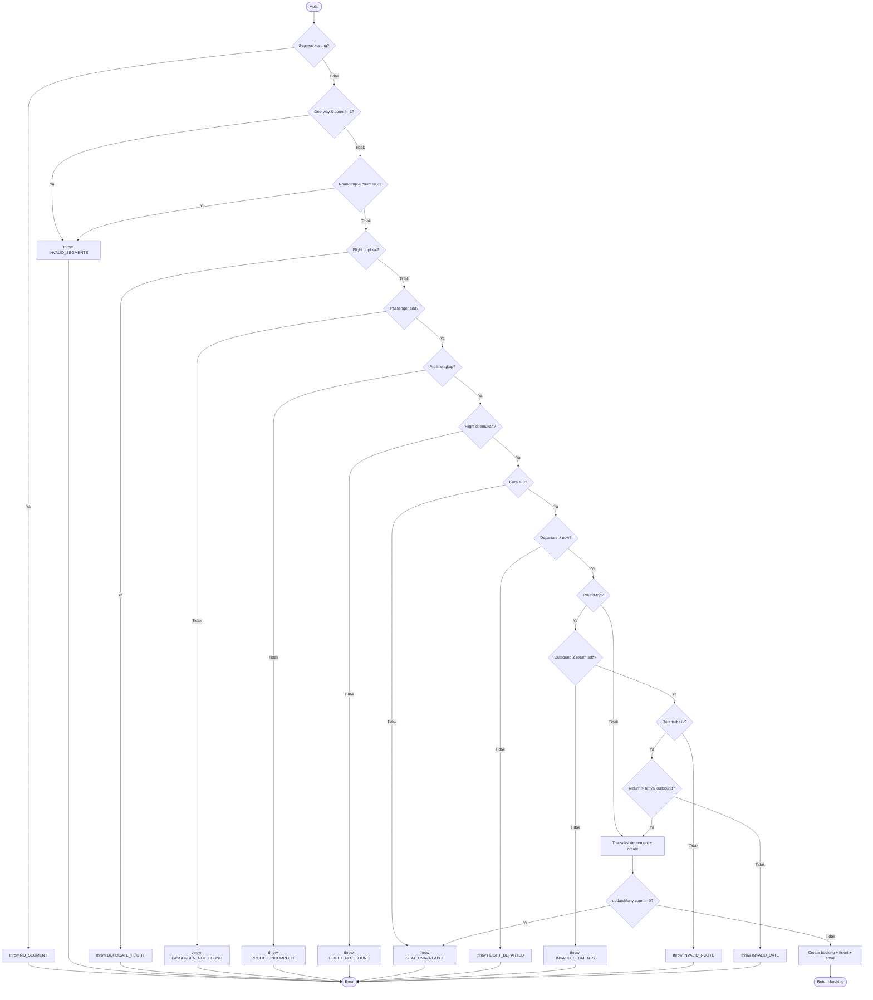
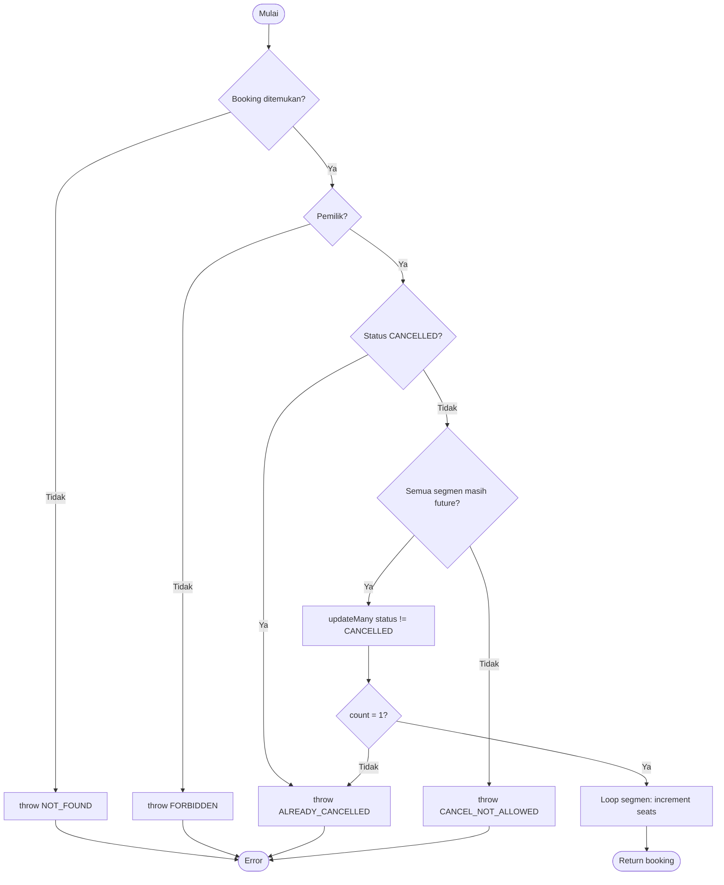
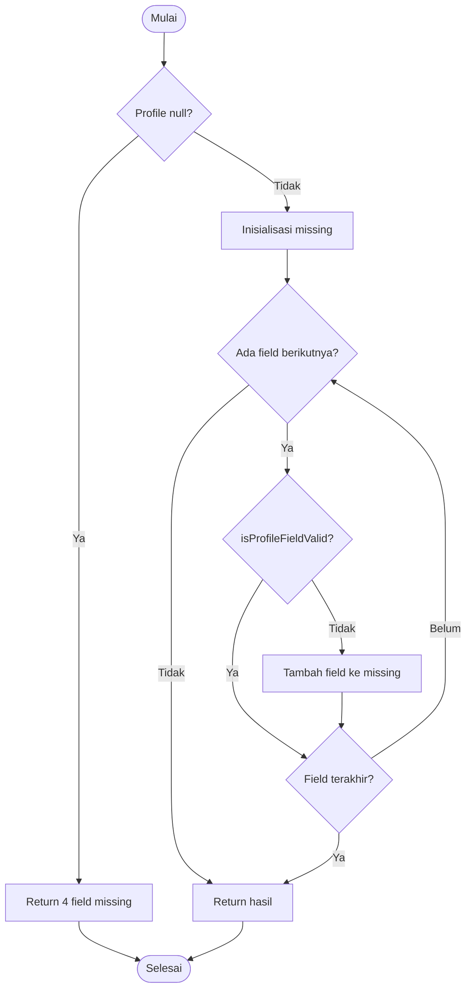

# 03 — Whitebox Testing

Dokumen ini menjelaskan pengujian whitebox pada logika inti aplikasi: flowgraph, jalur
independen, cyclomatic complexity, dan pemetaan ke unit test. Fokus utama:
`createBooking`, `cancelBooking`, dan `checkProfileCompleteness`.

## 1. Lingkungan dan cakupan

| Item | Nilai |
|---|---|
| Alat | Vitest 5.1.0 + `@vitest/coverage-v8` |
| Perintah | `npm run test:coverage` |
| Cakupan | `src/lib/domain`, `src/lib/services`, 3 file action, `src/lib/validation` |
| Bukan cakupan | Halaman RSC/JSX, hooks, `auth/session.ts`, `app/login/actions.ts`, `utils.ts` |
| Commit | commit final Sprint 8 (`git log -1 --oneline`) |

**Penting:** angka coverage adalah cakupan modul inti, bukan cakupan seluruh aplikasi.
Halaman diverifikasi melalui E2E. Batas ini dicantumkan agar tidak menimbulkan klaim berlebih.

## 2. Ringkasan coverage

| Metrik | Hasil | Ambang |
|---|---:|---:|
| Statements | 92,35% (592/641) | 85% |
| Branches | 83,97% (372/443) | 80% |
| Functions | 99,21% (126/127) | 90% |
| Lines | 94,19% (519/551) | 85% |

| Modul | Statements | Branches | Lines |
|---|---:|---:|---:|
| Domain `booking.ts` | 88,57% | 85,29% | 89,28% |
| Domain `flight.ts` | 98,24% | 98,18% | 97,82% |
| Domain `leave.ts` | 91,78% | 87,50% | 98,18% |
| Domain `profile.ts` | 97,43% | 93,54% | 100% |
| Service `booking-service.ts` | 97,39% | 91,04% | 98,03% |
| Service `flight-service.ts` | 92,85% | 81,81% | 100% |
| Service `itinerary-service.ts` | 95,45% | 87,50% | 95% |
| Service `leave-service.ts` | 97,61% | 70,00% | 97,22% |
| Service `member-service.ts` | 100% | 100% | 100% |
| Service `travel-service.ts` | 100% | 100% | 100% |
| Actions | 82,95% | 67,22% | 85,52% |
| Validation `booking.ts` | 100% | 75,00% | 100% |

> Angka diambil dari `coverage/coverage-summary.json` setelah penambahan test terakhir.
> Baris yang tidak tampil pada reporter teks tetap tersedia di JSON.

---

## 3. Fungsi utama 1 — `createBooking`

**Lokasi:** `src/lib/services/booking-service.ts`  
**Peran:** memvalidasi segmen, profil, kursi, jadwal, rute pulang-pergi; membuat referensi,
tiket, booking, dan email dalam satu transaksi.

### 3.1 Pseudocode

```
function createBooking(input):
  if segments kosong: throw NO_SEGMENT
  if one-way and count != 1: throw INVALID_SEGMENTS
  if round-trip and count != 2: throw INVALID_SEGMENTS
  if ada flightId duplikat: throw DUPLICATE_FLIGHT
  passenger = findUser(passengerId)
  if not passenger: throw PASSENGER_NOT_FOUND
  if profile tidak lengkap: throw PROFILE_INCOMPLETE
  flights = findFlights(ids)
  if jumlah flights != jumlah segmen: throw FLIGHT_NOT_FOUND
  untuk setiap segmen:
    if seats <= 0: throw SEAT_UNAVAILABLE
    if departure <= now: throw FLIGHT_DEPARTED
  if round-trip:
    if outbound atau return tidak ada: throw INVALID_SEGMENTS
    if origin/destination tidak terbalik: throw INVALID_ROUTE
    if return <= outbound.arrival: throw INVALID_DATE
  total = sum(harga)
  reference = uniqueReference()
  ticket = uniqueTicket()
  transaction:
    untuk setiap flight:
      updateMany(seats > 0, decrement 1)
      if count == 0: throw SEAT_UNAVAILABLE
    create booking + segments + ticket + emailOutbox
  return booking
```

### 3.2 Flowgraph



Jumlah predicate node: **14** (A, B, C, D, E, F, G, H, I, J, L, M, N, O).
**V(G) = P + 1 = 15.**

### 3.3 Basis path dan pemetaan test

| Path | Kondisi utama | Unit test |
|---|---|---|
| P1 | `segments.length === 0` | `menolak tanpa segmen` |
| P2 | one-way count ≠ 1 | `menolak sekali jalan dengan dua segmen` |
| P3 | round-trip count ≠ 2 | `menolak pulang-pergi dengan satu segmen` |
| P4 | flightId duplikat | `menolak penerbangan duplikat` |
| P5 | passenger tidak ada | `menolak jika penumpang tidak ditemukan` |
| P6 | profil tidak lengkap | `menolak pemesanan jika profil tidak lengkap` |
| P7 | flight tidak ditemukan | `menolak jika penerbangan tidak ditemukan` |
| P8 | kursi habis | `menolak jika kursi habis` |
| P9 | departure lewat | `menolak penerbangan yang sudah lewat` |
| P10 | round-trip tanpa return | `menolak pulang-pergi tanpa segmen kepulangan` |
| P11 | rute return tidak terbalik | `menolak pulang-pergi dengan rute yang tidak terbalik` |
| P12 | return sebelum arrival | `menolak kepulangan sebelum keberangkatan tiba` |
| P13 | transaksi kalah race kursi | `membatalkan transaksi jika kursi diambil request lain` |
| P14 | happy path one-way | `membuat pemesanan sekali jalan…` |
| P15 | happy path round-trip | `membuat pemesanan pulang-pergi…` |

15 path di atas setara dengan V(G)=15. Semua path memiliki test yang dieksekusi oleh
`tests/unit/booking-service.test.ts`.

---

## 4. Fungsi utama 2 — `cancelBooking`

**Lokasi:** `src/lib/services/booking-service.ts`  
**Peran:** memvalidasi kepemilikan/status/jadwal, membatalkan secara atomik, dan mengembalikan
kursi untuk semua segmen.

### 4.1 Pseudocode

```
function cancelBooking(bookingId, userId):
  booking = findBooking(include segments.flight)
  if not booking: throw NOT_FOUND
  if userId bukan booker/passenger: throw FORBIDDEN
  if status == CANCELLED: throw ALREADY_CANCELLED
  earliest = min(departure semua segmen)
  if earliest <= now: throw CANCEL_NOT_ALLOWED
  transaction:
    updated = updateMany(id, status != CANCELLED, set CANCELLED + cancelledAt)
    if updated.count == 0: throw ALREADY_CANCELLED
    untuk setiap segmen: increment seats
  return booking
```

### 4.2 Flowgraph



Predicate: A, B, C, D, G, loop H = 6. **V(G) = 7.**

Catatan: edge balik loop `H → H` tidak digambarkan agar diagram ringkas; `H` diperlakukan
sebagai predicate loop (increment kursi untuk setiap segmen).

### 4.3 Basis path

| Path | Kondisi | Test |
|---|---|---|
| P1 | booking tidak ada | `menolak pembatalan jika pemesanan tidak ditemukan` |
| P2 | bukan pemilik | `menolak pembatalan oleh pengguna lain` |
| P3 | sudah cancelled | `menolak pembatalan pemesanan yang sudah dibatalkan` |
| P4 | jadwal lewat | `menolak pembatalan jika jadwal sudah lewat` |
| P5 | race `updateMany` count 0 | `menolak pembatalan ganda secara atomik` |
| P6 | multi-segmen sukses | `mengembalikan kursi untuk semua segmen pulang-pergi` |
| P7 | satu segmen sukses | `membatalkan pemesanan dan mengembalikan kursi` |

---

## 5. Fungsi utama 3 — `checkProfileCompleteness`

**Lokasi:** `src/lib/domain/profile.ts`  
**Peran:** gerbang validasi tiket dan booking; memeriksa empat field wajib. Validasi
per-field didelegasikan ke helper `isProfileFieldValid` agar flowgraph fungsi utama tetap
sederhana dan dapat dipetakan ke test.

### 5.1 Pseudocode

```
function checkProfileCompleteness(profile):
  if profile null: return all fields missing
  missing = []
  untuk field in [fullName, nik, phone, birthDate]:
    if not isProfileFieldValid(field.key, profile[field.key]):
      tambahkan field ke missing
  return { complete: missing kosong, missingFields, missingLabels }

function isProfileFieldValid(key, value):
  jika key birthDate: valid bila Date valid / string YYYY-MM-DD valid secara kalender
  jika key nik: valid bila 16 digit
  jika key phone: valid bila 9..15 digit
  selain itu: valid bila string tidak kosong
```

### 5.2 Flowgraph fungsi utama



Predicate: A (profile null), D (loop masuk), E (valid?), G (loop lanjut) = **4**.
**V(G) = E − N + 2 = 13 − 10 + 2 = 5.**

Catatan: tabel di bawah adalah **path uji representatif** untuk cabang utama, bukan klaim
bahwa setiap varian iterasi loop adalah basis path independen. Loop memiliki empat field
tetap; variasi urutan field tidak mengubah logika.

Helper `isProfileFieldValid` memiliki cabang tipe field (birthDate/NIK/phone/nama) dan
aturan format masing-masing. Cabang helper diuji dengan 9 partisi pada
`tests/unit/profile.test.ts` (nama kosong, NIK valid/salah/alfanumerik, telepon
valid/pendek, tanggal Date valid, tanggal kalender tidak valid).

### 5.3 Path uji representatif

| Path | Kondisi | Test |
|---|---|---|
| P1 | profile null | `menangani profil null` |
| P2 | semua field valid | `menyatakan profil lengkap` |
| P3 | hanya NIK salah format | `mendeteksi NIK dengan format salah` |
| P4 | NIK + tanggal lahir kosong | `mendeteksi NIK dan tanggal lahir yang kosong` |
| P5 | hanya nama kosong | `mendeteksi nama kosong saat field lain valid` |

P1–P5 dijalankan oleh `tests/unit/profile.test.ts`. P3 dan P5 sama-sama melewati cabang
“invalid” tetapi berbeda field/iterasi; keduanya dipertahankan sebagai bukti partisi input,
bukan sebagai basis path independen tambahan.

Kelima path di atas dijalankan oleh `tests/unit/profile.test.ts`. `validateTicket` diuji
terpisah sebagai konsumen fungsi ini (valid, reject, tiket tidak ada); bukan bagian dari
flowgraph `checkProfileCompleteness`.

---

## 6. Fungsi pendukung

| Fungsi | Lokasi | V(G) perkiraan* | Fokus path | Test |
|---|---|---:|---|---|
| `validateMemberTicket` | member-service | 7 | tidak ada booking, tanpa tiket, cancelled, sudah valid, lengkap, reject, race | `member-service.test.ts` |
| `leavePeriodRange` | domain/leave | 6 | bulan invalid, hari invalid, Feb 31, rentang bulan | `leave.test.ts` |
| `isLeaveOverlappingPeriod` | domain/leave | 3 | beririsan, tidak, range terbalik | `leave.test.ts` |
| `calculateRemainingLeave` | domain/leave | 4 | approved only, kuota negatif, cross-year | `leave.test.ts` |
| `isWithinTimeWindow` | domain/flight | 5 | dua batas, satu batas, overnight, format invalid | `flight.test.ts` |
| `filterFlights` / `sortFlights` | domain/flight | 6 | rute, tanggal, harga, durasi, kosong | `flight.test.ts` |
| `createItinerary` | itinerary-service | 10 | nama, 0/5 segmen, sama, continuity, tanggal | `itinerary-service.test.ts` |
| `addItinerarySegment` | itinerary-service | 7 | not found, owner, max, continuity, date | `itinerary-service.test.ts` |

\* Nilai pada fungsi pendukung adalah perkiraan dari jumlah cabang utama; flowgraph penuh
hanya disusun untuk tiga fungsi utama. Nilai ini tidak digunakan sebagai klaim coverage.

---

## 7. Cakupan perilaku transaksi

`createBooking` diuji pada level service dengan Prisma di-mock. Hal yang diverifikasi:

1. `updateMany` dipanggil dengan syarat `seatsAvailable > 0` dan `decrement: 1`.
2. Bila `count === 0`, transaksi melempar `SEAT_UNAVAILABLE` sebelum booking dibuat.
3. Booking, segmen, tiket, dan email dibuat di dalam callback transaksi yang sama.
4. Pembatalan memakai `updateMany` bersyarat `status != CANCELLED`; kursi hanya dikembalikan
   bila transisi berhasil.
5. Multi-segmen mengembalikan kursi untuk setiap segmen.

Integrasi nyata (SQLite + Prisma) diverifikasi oleh E2E: seat berkurang setelah booking,
bertambah setelah pembatalan, dan email outbox muncul.

---

## 8. Keterbatasan whitebox

- Mock Prisma tidak mengeksekusi SQL/constraint nyata; E2E menutupi wiring database.
- Coverage halaman RSC, hooks, dan session JWT tidak diukur.
- Branch coverage action masih 67% (global 83%) karena beberapa cabang error generik tidak
  dipicu di unit test; jalur utama sudah tercakup.
- Tidak ada pengujian properti (property-based) atau fuzzing.
- Kompleksitas dihitung dari flowgraph yang disederhanakan pada level keputusan bisnis,
  bukan dari AST.
